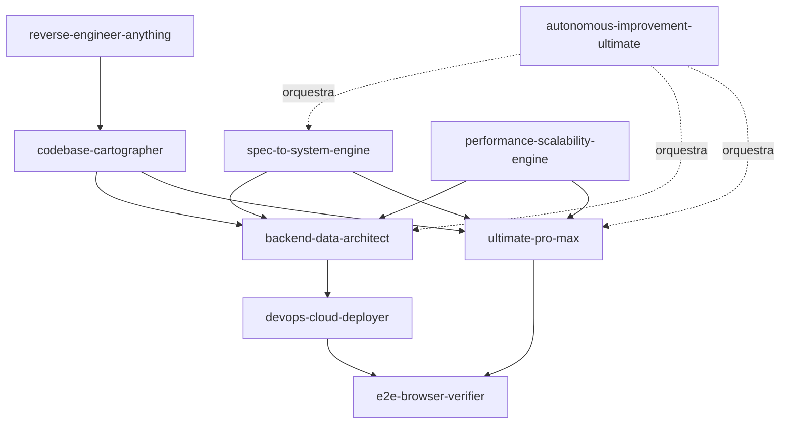

# dz23-arsenal

Coleção de 9 skills, 1 MCP e 1 bundle de engenharia para agentes de IA (Claude Code, DeepSeek Harness,
Cursor, Codex). Cada item é uma capacidade completa — não um prompt solto.


## O que é isto

Este repositório é um **arsenal de skills** para agentes de engenharia de software. Cada skill é
auto-contida: `SKILL.md` (as regras), `references/` (conhecimento carregado sob demanda), `templates/`
(artefatos preenchíveis), `scripts/` (código executável, quando existe) e `evals/` (cenários de
avaliação).

A ideia central é **evidência ou silêncio**: cada skill define o que conta como prova, o que é
`NOT_TESTED` e o que bloqueia a entrega. Não há "parece que funciona".

## Quick start (30 segundos)

```bash
# Clone
git clone https://github.com/LMPrado-DZ23/dz23-arsenal.git
cd dz23-arsenal

# Instale todas as skills (Windows)
.\scripts\install-all.ps1

# Ou Linux/Mac
./scripts/install-all.sh

# Verifique o que foi instalado e quais CLIs faltam
python scripts/audit-zips.py
pwsh scripts/verify-cli.ps1
```

As skills ficam em `~/.agents/skills/<nome>/` e são descobertas automaticamente por Claude Code, DeepSeek
Harness, Codex e Cursor (via junction/symlink de `~/.claude/skills` e `~/.codex/skills`).

## Índice — Skills DZ23 (9)

| Skill | Versão | Para quê | Quando usar |
|---|---|---|---|
| [`dz23-autonomous-improvement-ultimate`](skills/dz23-autonomous-improvement-ultimate/) | 2.1 | Loop de correção com evidência | Qualquer `/goal` de melhoria |
| [`dz23-backend-data-architect`](skills/dz23-backend-data-architect/) | 1.0.1 | Backend, DB, contratos | API, schema, migration |
| [`dz23-codebase-cartographer`](skills/dz23-codebase-cartographer/) | 1.1.0 | Mapeamento de codebase | Onboarding, antes de refactor |
| [`dz23-devops-cloud-deployer`](skills/dz23-devops-cloud-deployer/) | 1.2.1 | Deploy, CI/CD, IaC | Container, K8s, cloud |
| [`dz23-e2e-browser-verifier`](skills/dz23-e2e-browser-verifier/) | 1.1.0 | E2E com Playwright | Verificação de UI |
| [`dz23-performance-scalability-engine`](skills/dz23-performance-scalability-engine/) | 1.3.0 | Otimização 4 camadas | Performance, latência, budget |
| [`dz23-reverse-engineer-anything`](skills/dz23-reverse-engineer-anything/) | 1.1.1 | RE de binários/firmware | Análise de binário, CTF, audit |
| [`dz23-spec-to-system-engine`](skills/dz23-spec-to-system-engine/) | 1.2.0 | Spec executável | PRD, decomposição, Gherkin |
| [`dz23-ultimate-pro-max`](skills/dz23-ultimate-pro-max/) | 2.1 | Frontend/UI/UX | Componente, landing, a11y |

Índice detalhado com tabela comparativa: [`skills/README.md`](skills/README.md).

## Índice — MCP e Bundle

| Item | Tipo | Versão | Para quê |
|---|---|---|---|
| [`dz23-subagents-universal-mcp`](mcp/dz23-subagents-universal-mcp/) | MCP (Node) | 4.4.1 | Sub-agentes com 28 tools |
| [`dz23-dsh-agency`](bundle/dz23-dsh-agency/) | Bundle | 1.0.0 | 88 agentes especializados + Diretor |

## Skills externas recomendadas (8)

| Skill | Autor | Para quê | Repo |
|---|---|---|---|
| [Superpowers](external/superpowers.md) | obra | Planejamento + disciplina (SDLC) | [link](https://github.com/obra/superpowers) |
| [REA](external/rea.md) | morluto | Engenharia reversa + binários | [link](https://github.com/morluto/rea) |
| [Cloudflare Security Audit](external/cloudflare-security-audit.md) | cloudflare | Auditoria de segurança de source | [link](https://github.com/cloudflare/security-audit-skill) |
| [Anthropic Skills](external/anthropic-skills.md) | anthropic | skill-creator, mcp-builder, pdf, docx, xlsx, pptx | [link](https://github.com/anthropics/skills) |
| [Vercel React Best Practices](external/vercel-react-best-practices.md) | vercel-labs | Performance React/Next | [link](https://github.com/vercel-labs/agent-skills) |
| [Supabase Postgres Best Practices](external/supabase-postgres-best-practices.md) | supabase | Postgres/Supabase | [link](https://github.com/supabase/agent-skills) |
| [Playwright MCP](external/playwright-mcp.md) | microsoft | Testes E2E via MCP | [link](https://github.com/microsoft/playwright-mcp) |
| [Terraform AWS VPC](external/terraform-aws-vpc.md) | terraform-aws-modules | VPC AWS IaC | [link](https://github.com/terraform-aws-modules/terraform-aws-vpc) |

Cada linha linka para `external/<nome>.md` com instruções completas de instalação e uso.

## Pré-requisitos de CLI

- **Base para todas as skills**: `git`, `python` (3.10+), `node` (20+), `rg`, `jq`, `curl`
- **Por skill**: ver [`cli/required.md`](cli/required.md) — cada skill tem dependências próprias
  (`docker`/`kubectl`/`trivy` para devops, `playwright` para e2e, etc.)
- **O que falta nesta máquina**: ver [`cli/recommended.md`](cli/recommended.md) — inventário real,
  com prioridade ALTA/MÉDIA/BAIXA
- **Instalação**: [`cli/install-windows.md`](cli/install-windows.md) ou
  [`cli/install-linux.md`](cli/install-linux.md)
- **Verificação**: `pwsh scripts/verify-cli.ps1`

## Integração entre skills



Mapa detalhado (quem chama quem, e por quê): [`docs/integration-map.md`](docs/integration-map.md).

## Documentação

| Documento | Para quê |
|---|---|
| [`docs/getting-started.md`](docs/getting-started.md) | Do zero ao primeiro uso |
| [`docs/skills-overview.md`](docs/skills-overview.md) | Tabela comparativa das 9 skills |
| [`docs/integration-map.md`](docs/integration-map.md) | Como as skills se conectam |
| [`docs/installing-skills.md`](docs/installing-skills.md) | DZ23 → `~/.agents/skills` |
| [`docs/faq.md`](docs/faq.md) | Perguntas frequentes |
| [`cli/README.md`](cli/README.md) | Guia de CLIs |

## Como contribuir

Leia [`CONTRIBUTING.md`](CONTRIBUTING.md). Contribuição é bem-vinda em: correção de fato técnico,
novo eval que exponha uma falha real, e nova referência externa.

## Licença

MIT — ver [`LICENSE`](LICENSE).

## Créditos

As 9 skills DZ23 foram construídas ao longo de sessões de desenvolvimento iterativo, com auditoria por
três modelos diferentes (Claude, Gemini, ChatGPT) e verificação empírica contra o ambiente real. As
referências externas pertencem aos seus respectivos autores e mantêm suas licenças.

## Aviso honesto sobre evals

Cada skill traz `evals/evals.json` com 12–16 cenários. **A maioria nunca foi executada em harness real**
— o estado é `NOT_TESTED`, e está declarado no `CHANGELOG` de cada skill. Skill com eval não executado é
skill com comportamento não comprovado; trate os arquivos como especificação de comportamento, não como
certificado.
