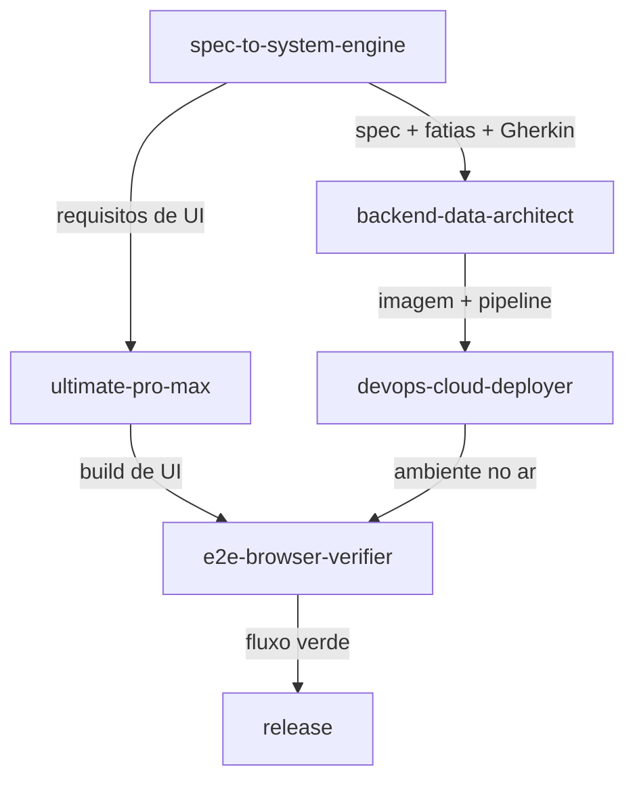
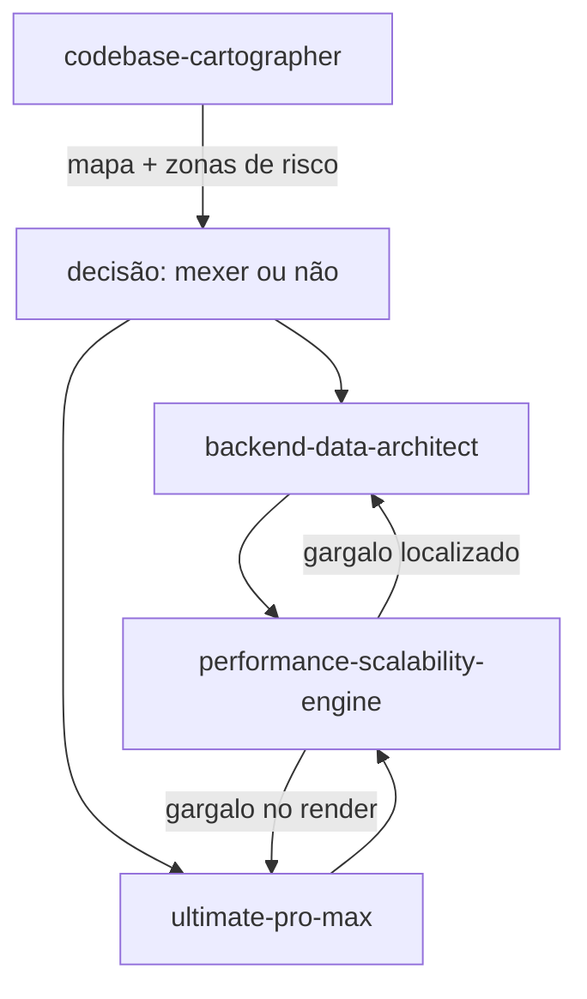
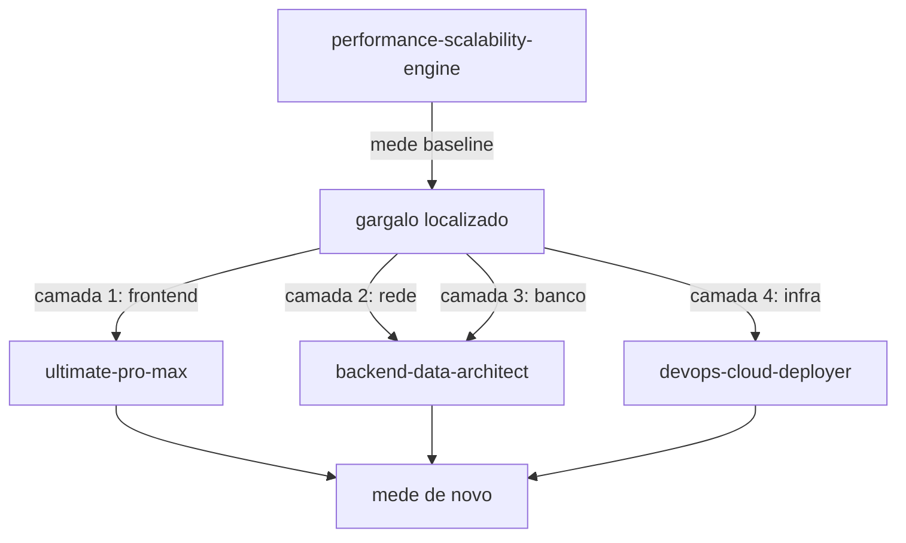
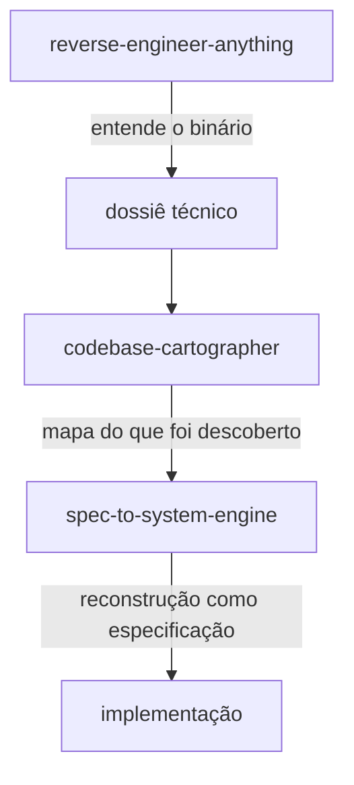
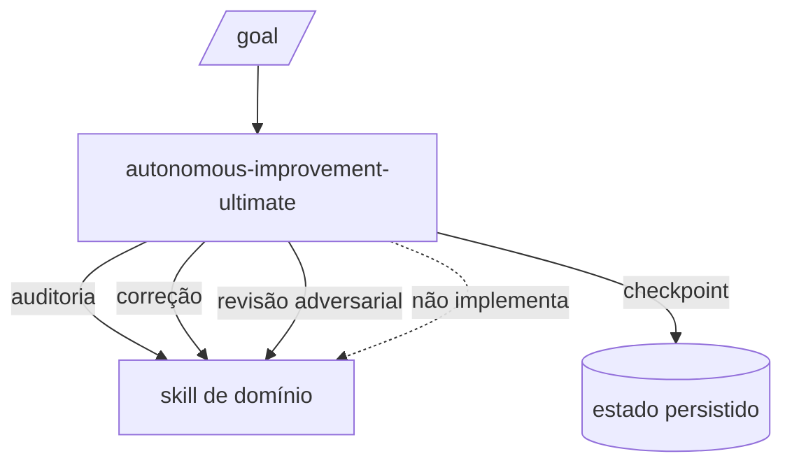

# Mapa de integração

Como as skills se conectam, quem chama quem e onde a informação muda de mão.

## Fluxo principal (feature nova)

O ponto de controle: **a spec é o contrato**. Se `backend` e `frontend` divergirem sobre o formato de um
payload, o que vale é o que está na spec — não o que foi implementado primeiro.

## Fluxo de mudança em código existente

O `cartographer` vem **antes** de qualquer mudança em código legado. Nenhuma skill deve "dar uma olhada
no código" por conta própria quando o repo é desconhecido.

## Fluxo de otimização

Regra: **uma camada por vez.** Duas mudanças simultâneas = nenhuma conclusão sobre qual funcionou.

## Fluxo de análise de artefato fechado

Usado quando o artefato é entregue sem fonte: app fechado, firmware, biblioteca sem código.

## Orquestração autônoma

`autonomous-improvement-ultimate` **não implementa**: ela decide o quê, delega para a skill de domínio,
cobra evidência e persiste o estado. É a única que pode chamar todas as outras.

## Regras de conexão

1. **Nunca dois orquestradores.** Só `autonomous-improvement-ultimate` orquestra; as outras decidem
   dentro do próprio domínio.
2. **A execução de código pertence à skill do domínio.** Performance mede e localiza; quem altera o
   código é backend ou frontend.
3. **O artefato da anterior é a entrada da próxima.** Spec → código → imagem → verificação. Se falta o
   artefato de entrada, a próxima skill declara `BLOCKED`, não improvisa.
4. **Nenhuma skill instala ferramenta sozinha.** Falta de CLI é `BLOCKED_BY_EXTERNAL_DEPENDENCY` com a
   dependência nomeada.

## Tabela de handoff

| De | Para | Artefato passado | Formato |
|---|---|---|---|
| spec | backend | requisitos + Gherkin + contrato | markdown |
| spec | frontend | requisitos de UI + estados | markdown |
| cartographer | qualquer | mapa + zonas de risco + ledger | markdown |
| backend | devops | Dockerfile + pipeline + envs | arquivos |
| frontend | e2e | rotas + fluxos críticos | lista |
| devops | e2e | URL do ambiente | string |
| performance | backend/frontend | gargalo + budget + evidência | markdown |
| RE | cartographer | dossiê do binário | markdown |
