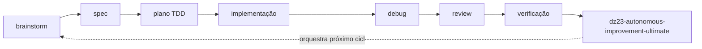

# Superpowers

**Autor:** obra
**Repo:** https://github.com/obra/superpowers
**Licença:** MIT (verificada via GitHub)
**Descrição oficial:** *"An agentic skills framework & software development methodology that works."*

## O que faz

Superpowers é um **framework de metodologia** empacotado como skills: brainstorm → spec → plano → TDD →
debug → revisão → verificação. A diferença em relação a um prompt de "faça um plano" é que cada etapa tem
artefato e critério de saída.

É a referência mais próxima de "processo de engenharia completo" disponível como skill, e influenciou o
desenho de `dz23-spec-to-system-engine` e de `dz23-autonomous-improvement-ultimate`.

**Multi-agente:** o repositório publica plugins por harness (`.claude-plugin`, `.codex-plugin`,
`.cursor-plugin`, `.devin-plugin`, `.hermes-plugin`, `.kimi-plugin`, `.muse-plugin`, `.opencode`, `.pi`,
`.antigravity-plugin`). Não é exclusivo do Claude Code.

## Por que usar em conjunto com DZ23

| Superpowers cobre | DZ23 cobre |
|---|---|
| processo de construção (plan → TDD → review) | gates de evidência por domínio |
| brainstorm e refino de ideia | spec executável com rastreabilidade REQ → TEST |
| ciclo de debug | loop autônomo com checkpoint e revisão adversarial |
| verificação pragmática | veredito `PASS` / `PARTIAL` / `FAIL` / `NOT_TESTED` explícito |

O encaixe: **Superpowers define o fluxo; DZ23 define o padrão de prova.** Quem já usa
`dz23-autonomous-improvement-ultimate` ganha a etapa de "como construir", que o loop DZ23 deliberadamente
não define (ele orquestra, não implementa).

### Onde encaixa no pipeline



## Instalação

**Claude Code (plugin):**
```
/plugin install superpowers@claude-plugins-official
```

**Outros harnesses:** use o diretório de plugin correspondente do repositório
(`.codex-plugin`, `.cursor-plugin`, `.opencode`, `.pi`…), conforme a documentação do seu agente.

**Manual:**
```bash
git clone https://github.com/obra/superpowers.git
cp -r superpowers/skills/* ~/.agents/skills/
```

## Exemplo de uso

```
"Quero adicionar autenticação por magic link. Usa o processo do Superpowers:
 brainstorm comigo, escreve a spec, quebra em plano, e só então implementa com TDD."
```

## Alternativas

- `dz23-spec-to-system-engine` — só a parte de especificação, com rastreabilidade formal.
- `dz23-autonomous-improvement-ultimate` — só o ciclo de correção com checkpoint.
- Superpowers é mais amplo; os três coexistem bem.

## Cuidados

- O pacote traz **muitas** skills de uma vez; instalar tudo polui o catálogo do agente. Instale o que for
  usar.
- Metodologia ≠ prova. Superpowers organiza o trabalho; quem diz se está pronto é o gate de evidência.
- Este documento **não** publica contagem de estrelas nem downloads: mudam toda semana e, sem verificação
  no momento da leitura, viram desinformação.
