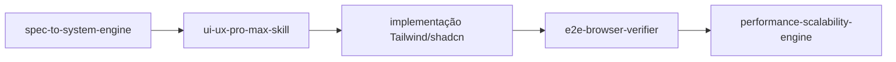

# UI UX Pro Max (skill de design intelligence)

**Autor:** nextlevelbuilder
**Repo:** https://github.com/nextlevelbuilder/ui-ux-pro-max-skill
**Site:** https://uupm.cc
**Licença:** MIT (verificada via GitHub)
**Stack da skill:** Python 3.x + CLI npm (`ui-ux-pro-max-cli`)

## O que faz

Skill de **design intelligence**: em vez de o modelo inventar estilo genérico ("gradiente roxo de IA"), ela
aplica um catálogo de regras de design por segmento e por stack. Os números declarados no próprio
repositório: **192 regras de raciocínio** e **80 estilos de UI pesquisáveis**.

Na prática, entrega antes do código:

- direção visual por tipo de produto (SaaS, FinTech, agendamento, cripto, landing page);
- tipografia real (pares de fontes), escala e pesos;
- paleta balanceada com contraste WCAG 2.2 AA (4.5:1 mínimo para texto normal);
- estados interativos: hover, active, focus-visible, disabled;
- regras por framework: Tailwind, shadcn/ui, React, Next.js, Vue, mobile (Flutter / React Native).

## Por que usar em conjunto com DZ23

| Skill DZ23 | O que faz | O que a externa acrescenta |
|---|---|---|
| `dz23-ultimate-pro-max` | direção de arte, componentes, gates de qualidade, QA visual | **catálogo por segmento** + regras prontas por stack |
| `dz23-e2e-browser-verifier` | verifica com browser real e evidência | nada — ela **valida** o que a externa desenhou |
| `dz23-performance-scalability-engine` | mede LCP/INP com baseline | nada — mede o resultado |

A relação correta: a externa **decide o desenho**, `ultimate-pro-max` **garante o padrão e a verificação**,
`e2e-browser-verifier` **prova que funciona**. Nenhuma substitui a outra.

### Onde encaixa no pipeline



## Instalação

Via CLI npm:

```bash
npx ui-ux-pro-max-cli@latest
```

Manual (como skill):

```bash
git clone https://github.com/nextlevelbuilder/ui-ux-pro-max-skill.git
cp -r ui-ux-pro-max-skill/skills/* ~/.agents/skills/
```

## Exemplo de uso

```
"Vou construir o dashboard de um SaaS de gestão financeira. Usa o UI UX Pro Max para gerar
 o design system: paleta com contraste AA, tipografia, escala de espaçamento e os estados
 de Button/Input/Dialog — antes de escrever componente."
```

## Alternativas

- `dz23-ultimate-pro-max` — direção de arte e gates DZ23 (não tem catálogo por segmento).
- `ui-ux-pro-max` (esta) — design intelligence por segmento e stack.
- Design system próprio da organização — se existir, ele precede qualquer catálogo externo.

## Cuidados

- **Design bonito não é design correto.** Toda tela gerada por ela ainda precisa passar por
  `dz23-e2e-browser-verifier` (fluxo + axe + evidência) e pelos contratos de `dz23-backend-data-architect`.
- Ela não substitui teste de acessibilidade real: contraste calculado ≠ teclado funcionando. Verifique com
  navegador.
- Regras por framework pressupõem stack; aplicar regra de Next em projeto Vue é ruído.
- Os números do repositório (192 regras, 80 estilos) mudam com o projeto — confira no README oficial.
- Este documento **não** publica contagem de estrelas: muda toda semana e, sem verificação, vira
  desinformação.
